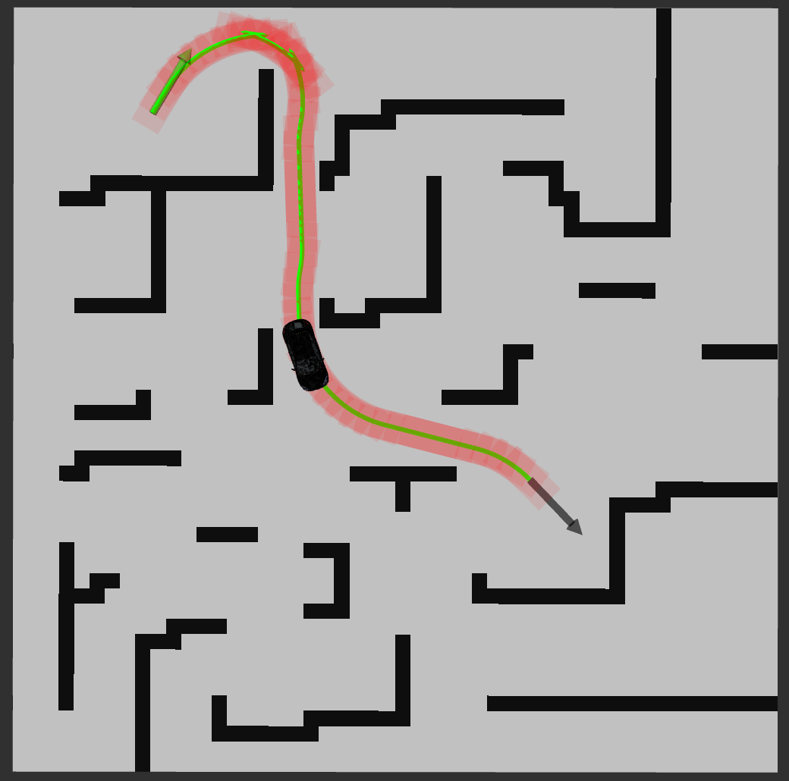
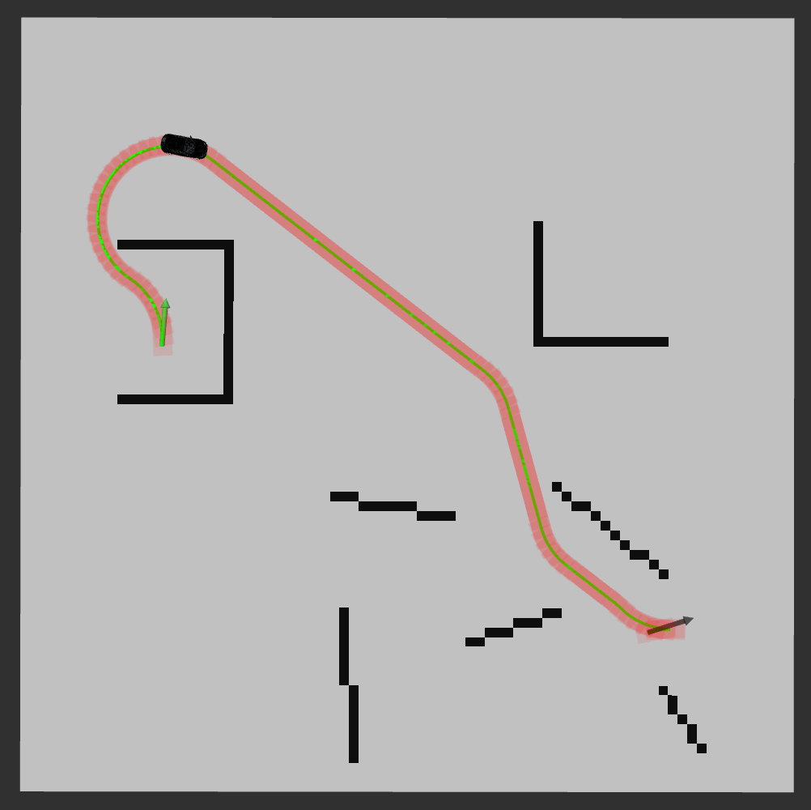
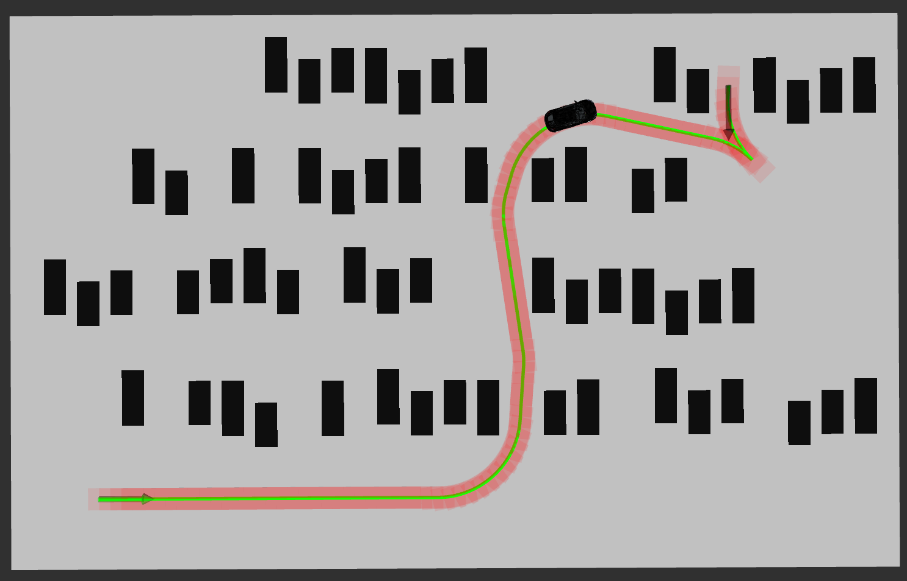
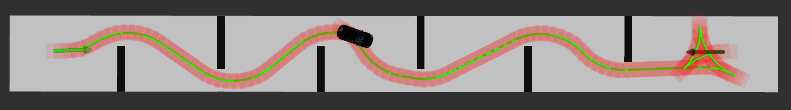

[**中文**](readme_cn.md)

## Update log

**2026.12.30:**

- Added trajectory post-processing and trajectory optimization; 
- Added richer documentation to facilitate parameter tuning;
- Added Docker support. 

# Hybrid A Star

## 1. Introduce

Hybrid A Star achieved very good results in the DARPA Urban Challenge. And after years of development, the algorithm has been verified to perform very well in parking and some autonomous driving environments without driving rules.

Since the author did not open source the algorithm, it took me weeks to reproduce the algorithm. The final result is close to the speed and effect in the paper.

**Video 0**: [bilibili](https://www.bilibili.com/video/BV1oU4y1d7xt?spm_id_from=333.999.0.0) | [YouTube](https://www.youtube.com/watch?v=MEc1jrEmg0o)

**Video 1**: [bilibili](https://www.bilibili.com/video/BV1qq4y1v77g?spm_id_from=333.999.0.0) | [YouTube](https://www.youtube.com/watch?v=eohHXEIpevg)

**Case 1**



**Case 2**



**Case 3**



**Case 4**



## 2. Prerequisites
**It is strongly recommended that you refer to Section 6 and run the program using Docker.**

(1). **C++14 Compiler**

(2). **ROS Noetic**: developed/tested on Noetic. Other ROS 1 versions (Melodic, etc.) should also work.

```shell
sudo apt-get install ros-noetic-costmap-* ros-noetic-map-server ros-noetic-tf
```

(3). **Eigen 3**

```shell
sudo apt-get install libeigen3-dev
```

(4).  **glog**

```shell
sudo apt-get install libgoogle-glog-dev
```

(5). **Ceres Solver** (back-end trajectory optimization)

```shell
sudo apt-get install libceres-dev
```

## 3. Build Hybrid A Star

```shell
# new folder
mkdir hybrid_a_star_ws/src -p
cd hybrid_a_star_ws/src

# Clone the repository
git clone https://github.com/zm0612/Hybrid_A_Star.git

# Build
cd hybrid_a_star_ws
catkin_make
```

## 4. Run Hybrid A Star

```shell
source devel/setup.bash
roslaunch hybrid_a_star run_hybrid_a_star.launch
```

**The starting point is selected by the `2D Pose Estimate` in rviz, and the end point is selected by the `2D Nav Goal`.**

> I provide multiple maps, you just need to modify the variable image in `hybrid_a_star/maps/map.yaml` file.

> If your start and end points are too close to obstacles, the collision detection mechanism may be triggered and no feasible paths will be searched and displayed

## 5. Trajectory post-processing & back-end optimization

In addition to the front-end search, the planner now runs a post-processing /
back-end stage on the searched path:

1. **Redundant reversal removal** — Hybrid A* often produces tiny forward/backward
   "shuffling" cusps near the start/goal. These short, net-zero reversals are
   detected and collapsed (a straight, collision-checked stitch replaces the
   wiggle), while genuine maneuvers such as a three-point turn are preserved.
2. **Ceres back-end optimization** — the cleaned path is refined with the
   [Ceres Solver](http://ceres-solver.org/). The cost combines:
   - **smoothness** (second-difference of consecutive points),
   - **reference** deviation (stay close to the front-end path),
   - **obstacle avoidance** using a *signed* ESDF (negative inside obstacles, so
     there is always a restoring gradient) and a **reciprocal barrier** penalty that
     diverges as the vehicle footprint approaches collision — so even a very large
     smoothness weight cannot push the path into an obstacle. The footprint is
     modelled as covering circles oriented by the **live** heading (from the
     neighbouring points), so the obstacle term tracks the actual vehicle shape as
     the path bends,
   - **curvature** soft-limit for non-holonomic / minimum-turning-radius
     feasibility,
   - **length** (total arc length) penalty — the second-difference smoothness
     term is a *curvature* penalty and is nearly blind to long-wavelength
     S-curves, so a single solve leaves a slow meander behind; the length term
     gives every point a direct incentive to straighten out, and the obstacle
     barrier keeps it from cutting corners.
     The start, goal and all gear-shift (cusp) points are held fixed, and no
     smoothness/curvature term crosses a reversal. The smoothness weight is also
     **tapered down near reversal points** (`opt_cusp_taper_*`) so the natural
     turn-in geometry of a gear change is preserved instead of being flattened,
     while the path is still fully smoothed away from reversals. The whole
     optimize + resample cycle is repeated `opt_num_passes` times so
     low-frequency sway is relaxed progressively (a single pass mostly removes
     only high-frequency jitter).

rviz shows both the raw path (`searched_path`, green) and the optimized path
(`optimized_path`, red) for comparison. All weights, clearance, curvature limit
and the reversal-removal thresholds are exposed as `planner/opt_*` parameters in
`launch/run_hybrid_a_star.launch`.

Relevant source files:

- `include/hybrid_a_star/trajectory.h` — trajectory type + gear (direction) inference
- `include/hybrid_a_star/path_processor.{h,cpp}` — redundant reversal removal
- `include/hybrid_a_star/esdf.{h,cpp}` — ESDF distance field
- `include/hybrid_a_star/trajectory_optimizer.{h,cpp}` — Ceres optimizer

## 6. Run with Docker (ROS Noetic + rviz)

A Docker image bundles ROS Noetic, Ceres, and the built workspace. The container
runs rviz on the host display via X11.

```shell
# From the repository root:
./run_docker.sh            # builds the image on first run, then launches rviz

# Other modes:
./run_docker.sh build      # force-rebuild the image
./run_docker.sh bash       # interactive shell inside the container
```

Then use `2D Pose Estimate` / `2D Nav Goal` in rviz exactly as in the native run.

If rviz does not appear, allow local X connections on the host first:

```shell
xhost +local:docker
```

> The script passes `--net=host`, `-e DISPLAY` and mounts `/tmp/.X11-unix` so the
> containerized rviz uses your host X server. It targets a Linux host with an X
> server. On Wayland you may need `xhost +SI:localuser:root` or an XWayland setup.

## 7.How to adjust parameters?

❤️ [launch参数说明](docs/launch参数说明.md)

## 8. References


(1). [Practical Search Techniques in Path Planning for Autonomous Driving](https://ai.stanford.edu/~ddolgov/papers/dolgov_gpp_stair08.pdf)

(2). [The Bresenham Line-Drawing Algorithm](https://www.cs.helsinki.fi/group/goa/mallinnus/lines/bresenh.html)

(3). [A simple car](http://planning.cs.uiuc.edu/node658.html)
