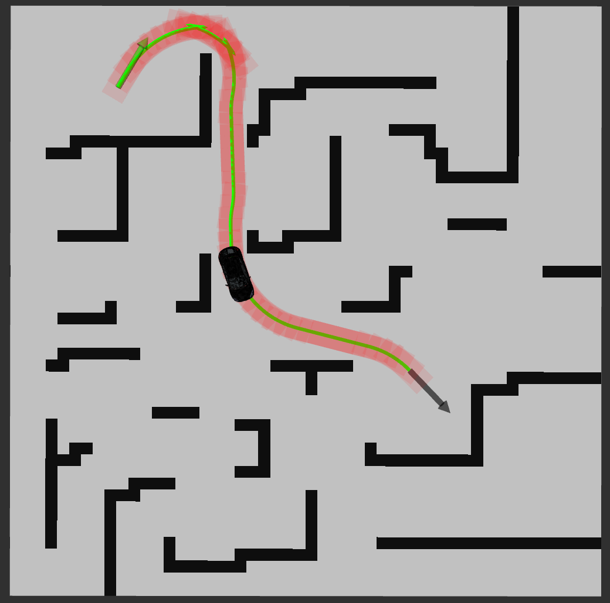
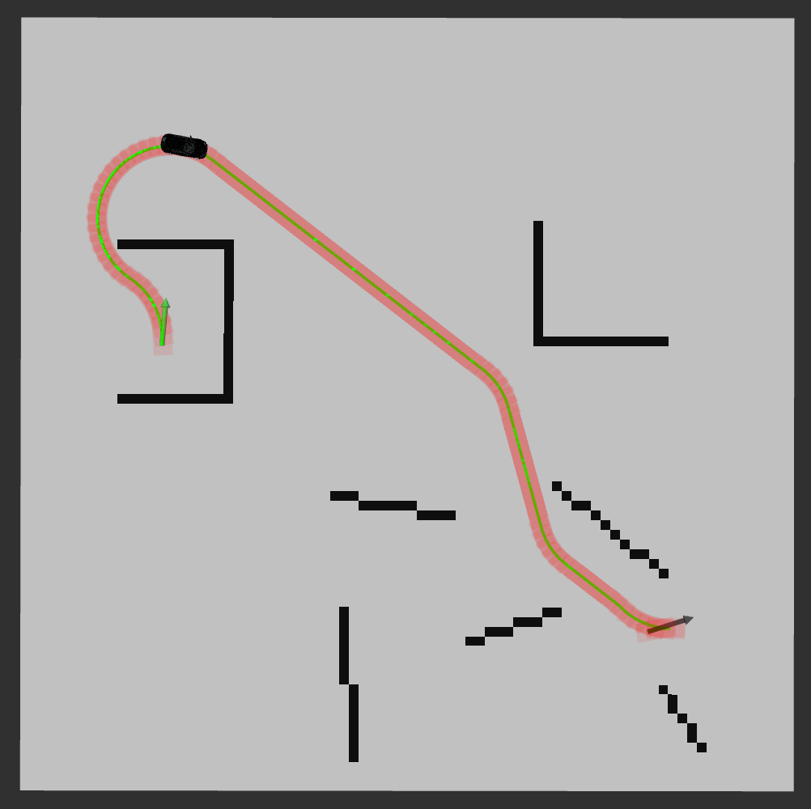
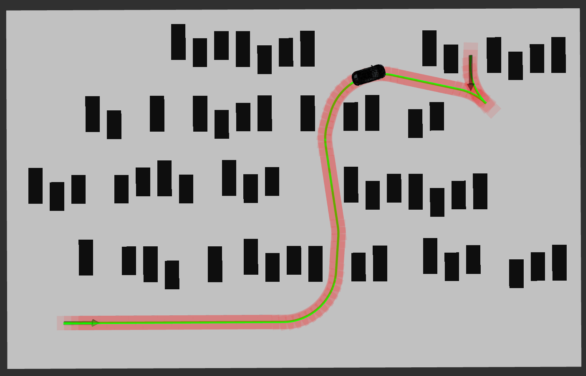
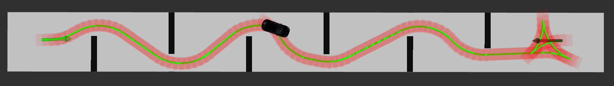

[**English**](readme.md)

## 更新日志

**2026.12.30:**

- 增加轨迹后处理和轨迹优化；
- 增加更丰富的文档便于调参；
- 支持使用docker。

# Hybrid A Star

## 1. 简介

Hybrid A Star 在 DARPA 城市挑战赛中取得了非常好的成绩。经过多年发展，该算法已被验证在泊车以及一些无驾驶规则的自动驾驶场景中表现非常出色。

由于原作者没有开源该算法，我花了数周时间复现了它。最终结果在速度和效果上都接近论文中的水平。

**视频 0**: [bilibili](https://www.bilibili.com/video/BV1oU4y1d7xt?spm_id_from=333.999.0.0) | [YouTube](https://www.youtube.com/watch?v=MEc1jrEmg0o)

**视频 1**: [bilibili](https://www.bilibili.com/video/BV1qq4y1v77g?spm_id_from=333.999.0.0) | [YouTube](https://www.youtube.com/watch?v=eohHXEIpevg)

**案例 1**



**案例 2**



**案例 3**



**案例 4**



## 2. 依赖项
**强烈建议参考第6节，使用docker运行程序。**

(1). **C++14 编译器**

(2). **ROS Noetic**: 在 Noetic 上开发/测试。其他 ROS 1 版本（Melodic 等）应该也能使用。

```shell
sudo apt-get install ros-noetic-costmap-* ros-noetic-map-server ros-noetic-tf
```

(3). **Eigen 3**

```shell
sudo apt-get install libeigen3-dev
```

(4). **glog**

```shell
sudo apt-get install libgoogle-glog-dev
```

(5). **Ceres Solver** (后端轨迹优化)

```shell
sudo apt-get install libceres-dev
```

## 3. 编译 Hybrid A Star

```shell
# 新建文件夹
mkdir hybrid_a_star_ws/src -p
cd hybrid_a_star_ws/src

# 克隆仓库
git clone https://github.com/zm0612/Hybrid_A_Star.git

# 编译
cd hybrid_a_star_ws
catkin_make
```

## 4. 运行 Hybrid A Star

```shell
source devel/setup.bash
roslaunch hybrid_a_star run_hybrid_a_star.launch
```

**起点通过 rviz 中的 `2D Pose Estimate` 选取，终点通过 `2D Nav Goal` 选取。**

> 我提供了多张地图，你只需要修改 `hybrid_a_star/maps/map.yaml` 文件中的变量 image 即可。

> 如果你的起点和终点离障碍物太近，可能会触发碰撞检测机制，导致搜索不到可行路径并无法显示。

## 5. 轨迹后处理与后端优化

除了前端搜索之外，规划器现在还会对搜索到的路径执行后处理 /
后端阶段：

1. **冗余倒车去除** — Hybrid A* 经常在起点/终点附近产生微小的前进/后退
   "来回倒腾"尖点。这些短的、净位移为零的倒车会被检测并折叠（用一段
   经过碰撞检测的直线拼接来替换这种摆动），而真正的机动动作（如三点掉头）
   会被保留下来。
2. **Ceres 后端优化** — 清理后的路径使用
   [Ceres Solver](http://ceres-solver.org/) 进行精化。代价函数组合了：
   
   - **平滑性**（相邻点的二阶差分），
   - **参考路径偏差**（保持接近前端路径），
   - **避障**，使用带符号的 ESDF（障碍物内部为负值，因此始终存在恢复梯度）
     以及一种**倒数障碍**（reciprocal barrier）惩罚，当车辆轮廓接近碰撞时
     该惩罚趋于发散——因此即使再大的平滑权重也无法将路径推入障碍物中。
     车辆轮廓用一组覆盖圆建模，其方向由**实时**航向（来自相邻点）确定，
     因此障碍项会随路径弯曲跟踪实际的车辆形状，
   - **曲率**软约束，用于保证非完整约束 / 最小转弯半径的可行性，
   - **长度**（总弧长）惩罚——二阶差分平滑项本质上是一种*曲率*惩罚，
     对长波长的 S 形曲线几乎不敏感，所以单次求解后会留下缓慢的蜿蜒；
     长度项给每个点一个直接拉直的激励，而障碍惩罚则防止其切角。
   
   起点、终点和所有换挡（尖点）点保持固定，且任何平滑/曲率项都不会跨越
   倒车点。平滑权重还会在**倒车点附近递减**（`opt_cusp_taper_*`），以保留
   换挡时自然的转向几何形状而不是将其压平，同时在远离倒车点的地方路径
   仍然被完全平滑。整个"优化 + 重采样"循环会重复 `opt_num_passes` 次，
   使低频摆动逐步松弛（单次遍历主要只消除高频抖动）。

rviz 会同时显示原始路径（`searched_path`，绿色）和优化后的路径
（`optimized_path`，红色）以便对比。所有权重、安全间隙、曲率限制和
倒车去除阈值都作为 `planner/opt_*` 参数暴露在
`launch/run_hybrid_a_star.launch` 中。

相关源文件：

- `include/hybrid_a_star/trajectory.h` — 轨迹类型 + 挡位（方向）推断
- `include/hybrid_a_star/path_processor.{h,cpp}` — 冗余倒车去除
- `include/hybrid_a_star/esdf.{h,cpp}` — ESDF 距离场
- `include/hybrid_a_star/trajectory_optimizer.{h,cpp}` — Ceres 优化器

## 6. 使用 Docker 运行（ROS Noetic + rviz）

Docker 镜像打包了 ROS Noetic、Ceres 和已编译的工作空间。容器通过 X11
在宿主机显示器上运行 rviz。

```shell
# 在仓库根目录下执行：
./run_docker.sh            # 首次运行时会构建镜像，然后启动 rviz

# 其他模式：
./run_docker.sh build      # 强制重新构建镜像
./run_docker.sh bash       # 在容器内进入交互式 shell
```

然后像本地运行一样，在 rviz 中使用 `2D Pose Estimate` / `2D Nav Goal`。

如果 rviz 没有出现，请先在宿主机上允许本地 X 连接：

```shell
xhost +local:docker
```

> 该脚本传递了 `--net=host`、`-e DISPLAY` 并挂载了 `/tmp/.X11-unix`，
> 使容器内的 rviz 使用宿主机的 X 服务器。它面向带有 X 服务器的 Linux
> 宿主机。在 Wayland 上你可能需要 `xhost +SI:localuser:root` 或 XWayland
> 配置。

## 7. 如何调整参数？

❤️ [launch参数说明](docs/launch参数说明.md)

## 8. 参考文献

(1). [Practical Search Techniques in Path Planning for Autonomous Driving](https://ai.stanford.edu/~ddolgov/papers/dolgov_gpp_stair08.pdf)

(2). [The Bresenham Line-Drawing Algorithm](https://www.cs.helsinki.fi/group/goa/mallinnus/lines/bresenh.html)

(3). [A simple car](http://planning.cs.uiuc.edu/node658.html)
